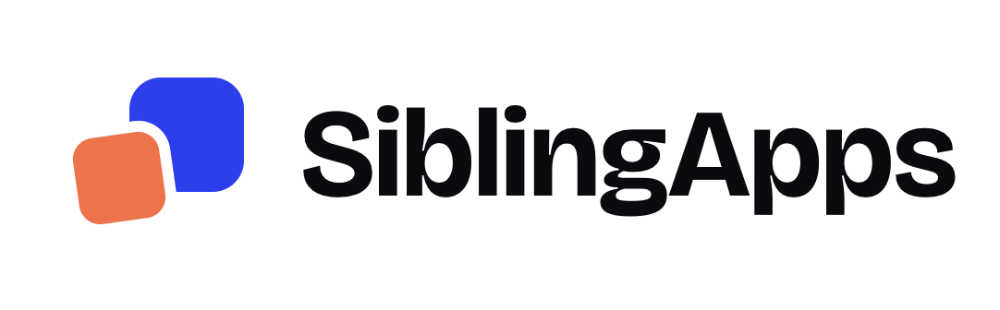
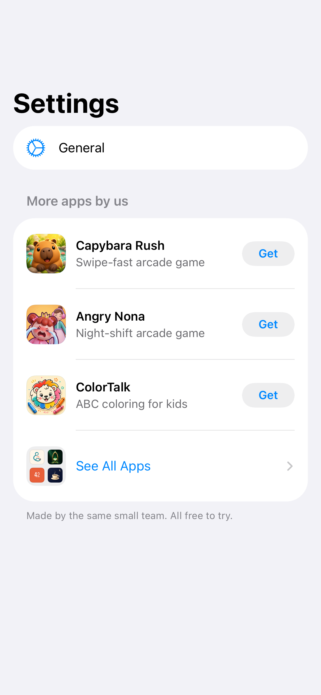
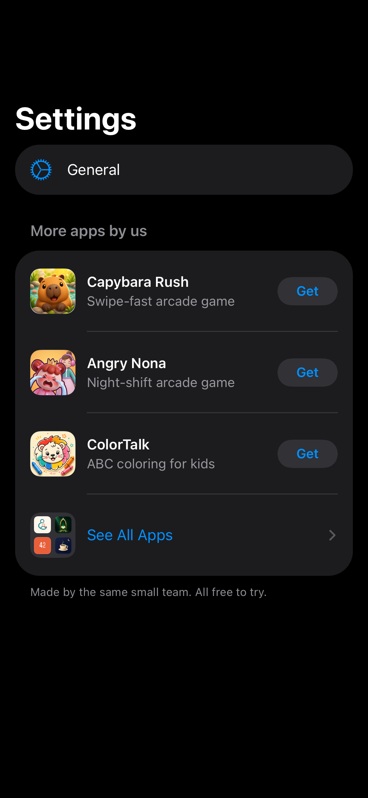

<p align="center">
  <picture>
    <source media="(prefers-color-scheme: dark)" srcset=".github/brand/logo-dark.png">
    
  </picture>
</p>

<p align="center"><b>Show your other apps in the Settings screen of your SwiftUI app.</b></p>

<p align="center">
  
  
  
  <a href="LICENSE"></a>
  <a href="https://github.com/Abdo-codes/SiblingApps/actions/workflows/ci.yml"></a>
</p>

<p align="center">
  
  &nbsp;
  
</p>

You make more than one app. Each app can help people find the others. This package adds a small "More apps by us" section to Settings, a full list of your apps, and the App Store sheet. It works on iPhone and iPad, in English and Arabic (RTL), and in light and dark mode.

- **Settings section:** your featured apps and a "See All Apps" row.
- **All Apps screen:** a list on iPhone and a grid of cards on iPad. Apple TV and Mac apps are in their own group.
- **In-app App Store page:** a tap opens the App Store sheet. If the app is installed, the tap opens the app.
- **No self-promotion:** the package hides the app that shows the section.
- **Remote catalog:** add a new app to a JSON file on your server. It appears without an app update.

## Quick start

1. Add the package: `https://github.com/Abdo-codes/SiblingApps`.
2. List your apps:

   ```swift
   import SiblingApps

   let moreApps = SiblingAppsConfiguration(
     catalog: .inline(Catalog(schemaVersion: 1, apps: [
       CatalogApp(
         id: 1234567890,  // the App Store ID
         bundleID: "com.example.notes",
         name: LocalizedText(["en": "Notes Pro"]),
         subtitle: LocalizedText(["en": "Write anything"]),
         category: LocalizedText(["en": "Productivity"]),
         platforms: [.iPhone, .iPad],
         iconURL: URL(string: "https://example.com/notes.png")
       )
     ]))
   )
   ```

3. Put the section in your Settings list:

   ```swift
   NavigationStack {
     List {
       // Your sections …
       SiblingAppsSection(configuration: moreApps)
     }
   }
   ```

## Installation

**Xcode:** select **File > Add Package Dependencies**, enter the URL, and add the `SiblingApps` library to your app target.

**Package.swift:**

```swift
dependencies: [
  .package(url: "https://github.com/Abdo-codes/SiblingApps", from: "0.4.0"),
],
targets: [
  .target(name: "MyApp", dependencies: [
    .product(name: "SiblingApps", package: "SiblingApps"),
  ]),
]
```

## Usage

The section must be in a `List` or `Form` inside a `NavigationStack`. If the catalog has no apps other than the host app, the section shows nothing.

### A catalog in code

Use `.inline(Catalog(...))`, as in the quick start. This is good for a short list.

### A JSON file in your app

Add `catalog.json` to your app target (see [JSON schema](#json-schema)) and use `.bundled(.main)`:

```swift
let moreApps = SiblingAppsConfiguration(catalog: .bundled(.main))
```

To use a different file name, pass `.bundled(.main, resource: "my-apps")`.

### Icons

The package downloads `iconURL` for each app. To show icons with no download, add 180 × 180 px images named `appicon-<App Store ID>` to an asset catalog. A `.bundled` catalog finds them in its own bundle. For an `.inline` catalog, set the bundle:

```swift
SiblingAppsConfiguration(catalog: .inline(catalog), iconBundle: .main)
```

### Show "Open" for installed apps

Give each app a `urlScheme` in the catalog, and add the schemes to the `Info.plist` of the host app:

```xml
<key>LSApplicationQueriesSchemes</key>
<array>
  <string>notespro</string>
</array>
```

If a scheme is not in this list, the app shows "Get".

## Remote catalog

Host the same JSON on your server and set `remoteCatalogURL`. When the screen appears, the package downloads the file and caches it. With no cache and no network, it uses `catalog`.

```swift
SiblingAppsConfiguration(
  catalog: .bundled(.main),
  remoteCatalogURL: URL(string: "https://example.com/apps/catalog.json")
)
```

## Customization

| Setting | Default | What it does |
|---------|---------|--------------|
| `catalog` | `.inline(.empty)` | The apps to show. |
| `iconBundle` | the bundle of a `.bundled` catalog | The bundle with the `appicon-<id>` images. |
| `remoteCatalogURL` | `nil` | A hosted catalog. |
| `featuredCount` | `3` | The number of apps in the Settings section. |
| `campaignToken` | `"more-apps"` | App Store Connect shows it in App Analytics > Sources. |
| `providerToken` | `nil` | Your provider ID. App Analytics needs it to attribute campaigns. |
| `onEvent` | no-op | Gets a `SiblingAppsEvent` when the All Apps screen shows or a person taps an app. Send it to your own analytics. |
| `hostBundleID`, `hostAppName` | from `Bundle.main` | The host app, which the package hides. |

### Your own Settings design

If your Settings screen is not a `List` (cards in a `ScrollView`, a game menu), draw one row in your style and present `SiblingAppsSheet`. The sheet has its own navigation stack and a Done button. `SiblingAppsIcon` draws the 2×2 icon of your apps.

```swift
Button {
  showsSiblingApps = true
} label: {
  HStack {
    SiblingAppsIcon(configuration: moreApps, size: 40)
    Text(SiblingAppsStrings.rowTitle)
  }
}
.sheet(isPresented: $showsSiblingApps) {
  SiblingAppsSheet(configuration: moreApps)
}
```

`SiblingAppsView(configuration:)` is the full screen with no navigation stack, if you want to push it yourself.

## JSON schema

```json
{
  "schemaVersion": 1,
  "apps": [
    {
      "id": 1234567890,
      "bundleID": "com.example.notes",
      "name": { "en": "Notes Pro" },
      "subtitle": { "en": "Write anything", "ar": "اكتب أي شيء" },
      "category": { "en": "Productivity", "ar": "الإنتاجية" },
      "platforms": ["iPhone", "iPad"],
      "iconURL": "https://example.com/notes.png",
      "urlScheme": "notespro"
    }
  ]
}
```

| Field | Required | Description |
|-------|----------|-------------|
| `schemaVersion` | Yes | Use `1`. |
| `id` | Yes | The App Store ID. |
| `bundleID` | Yes | The package hides the app with the bundle ID of the host. |
| `name`, `subtitle`, `category` | Yes | One value for each language code. A missing language uses `en`. |
| `platforms` | Yes | `iPhone`, `iPad`, `appleTV`, `mac`. iPad also shows iPhone apps. |
| `iconURL` | No | Used when no icon is bundled. |
| `urlScheme` | No | Shows "Open" for an installed app. |

The order of `apps` is the display order. The package skips an entry that does not decode and ignores unknown platforms, so old app versions keep working when you add new fields.

## Requirements

- iOS 17 or later (iPhone and iPad)
- Swift 6 (Xcode 16 or later)
- One dependency: [swift-dependencies](https://github.com/pointfreeco/swift-dependencies)

## Privacy

- The package does no tracking and collects no data.
- It makes no network calls, unless you set `remoteCatalogURL` or a catalog app has an `iconURL` with no bundled icon.
- `onEvent` stays in your app. You decide if it goes to your analytics.
- `canOpenURL` checks only the schemes that you list in `LSApplicationQueriesSchemes`.

## Contributing

Issues and pull requests are welcome. New languages for the built-in text are a great first contribution.

1. Fork the repo and make a branch.
2. Run the tests:

   ```bash
   xcodebuild test -scheme SiblingApps-Package -destination 'platform=iOS Simulator,name=iPhone 17'
   ```

3. If a screen changes, delete its old snapshots and run the tests two times to record them again. The snapshot tests need the same simulator for each run, so CI skips them.
4. Add a line to [CHANGELOG.md](CHANGELOG.md) and open a pull request.

## License

The code is MIT. See [LICENSE](LICENSE).

The `SiblingAppsAbdoCatalog` product holds the catalog and icons of the author's own apps. These brand assets are not under the MIT license, so do not ship them in your app. See [NOTICE](NOTICE).
