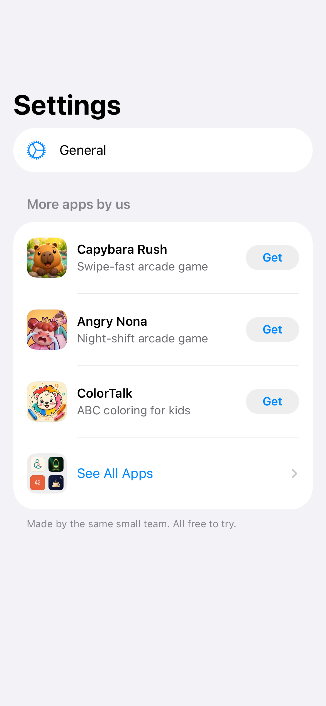

# MoreApps

A SwiftUI package that shows your other App Store apps in the Settings screen of an app. Use it to cross-promote the apps of one developer account.

- **Settings section:** the featured apps and a "See All Apps" row.
- **All Apps screen:** a list on iPhone and a grid of cards on iPad. Apps for Apple TV and Mac are in a separate group.
- **App Store sheet:** a tap shows the App Store page in the app (`SKStoreProductViewController`). If an app is installed, the tap opens it.
- **No self-promotion:** the package hides the host app by its bundle ID.
- **Remote catalog:** host a JSON file, and new apps appear without an app update.
- English and Arabic (RTL), light and dark mode.



## Requirements

- iOS 17 or later (iPhone and iPad)
- Swift 6 (Xcode 16 or later)

## Install

In Xcode, select **File > Add Package Dependencies**, enter the URL below, and add the `MoreApps` library to the app target.

```
https://github.com/Abdo-codes/MoreApps
```

In `Package.swift`:

```swift
.package(url: "https://github.com/Abdo-codes/MoreApps", from: "0.3.0"),
// …
.product(name: "MoreApps", package: "MoreApps"),
```

## Quick start

Give your apps to the package and put the section in your Settings `List`:

```swift
import MoreApps

let moreApps = MoreAppsConfiguration(
  catalog: .inline(
    Catalog(schemaVersion: 1, apps: [
      CatalogApp(
        id: 1234567890,  // the App Store ID
        bundleID: "com.example.notes",
        name: LocalizedText(["en": "Notes Pro"]),
        subtitle: LocalizedText(["en": "Write anything"]),
        category: LocalizedText(["en": "Productivity"]),
        platforms: [.iPhone, .iPad],
        iconURL: URL(string: "https://example.com/notes.png")
      )
    ])
  )
)

NavigationStack {
  List {
    // Your sections …
    MoreAppsSection(configuration: moreApps)
  }
}
```

The section must be in a `List` or `Form` inside a `NavigationStack`. To show the full screen yourself, push `MoreAppsView(configuration:)`. If the catalog has no apps for this device other than the host app, the section shows nothing.

## Your catalog

### Option 1: a JSON file in the app

Add `catalog.json` to the app target and use `.bundled(.main)`:

```swift
MoreAppsConfiguration(catalog: .bundled(.main))
```

The format:

```json
{
  "schemaVersion": 1,
  "apps": [
    {
      "id": 1234567890,
      "bundleID": "com.example.notes",
      "name": { "en": "Notes Pro" },
      "subtitle": { "en": "Write anything", "ar": "اكتب أي شيء" },
      "category": { "en": "Productivity", "ar": "الإنتاجية" },
      "platforms": ["iPhone", "iPad"],
      "iconURL": "https://example.com/notes.png",
      "urlScheme": "notespro"
    }
  ]
}
```

| Field | Required | Description |
|-------|----------|-------------|
| `id` | Yes | The App Store ID. |
| `bundleID` | Yes | The package hides the app with the bundle ID of the host. |
| `name`, `subtitle`, `category` | Yes | One value for each language code. A missing language uses `en`. |
| `platforms` | Yes | `iPhone`, `iPad`, `appleTV`, `mac`. iPad also shows iPhone apps. |
| `iconURL` | No | The package downloads it when no icon is bundled. |
| `urlScheme` | No | It shows "Open" for an installed app. See below. |

The order in the file is the display order. The package skips an entry that does not decode.

### Option 2: a catalog in code

Use `.inline(Catalog(...))`, as in the quick start.

### Bundled icons

To show icons with no download, add images named `appicon-<App Store ID>` (180 × 180 px) to an asset catalog. A `.bundled` catalog looks for them in its own bundle. For an `.inline` catalog, set the bundle:

```swift
MoreAppsConfiguration(catalog: .inline(catalog), iconBundle: .main)
```

### Remote catalog

Host the same JSON format and set `remoteCatalogURL`. The package downloads it when the screen appears and caches the last download. With no cache, it uses `catalog`.

```swift
MoreAppsConfiguration(
  catalog: .bundled(.main),
  remoteCatalogURL: URL(string: "https://example.com/apps/catalog.json")
)
```

## Themed Settings screens

If the Settings screen is a custom layout (cards in a `ScrollView`, a game menu), draw one row in your own style and present `MoreAppsSheet` from it. The sheet has its own navigation stack and a Done button. `MoreAppsIcon` gives the 2×2 icon for the row.

```swift
Button {
  showsMoreApps = true
} label: {
  HStack {
    MoreAppsIcon(configuration: moreApps, size: 40)
    Text(MoreAppsStrings.rowTitle)
  }
}
.sheet(isPresented: $showsMoreApps) {
  MoreAppsSheet(configuration: moreApps)
}
```

## Configuration

```swift
MoreAppsConfiguration(
  catalog: .bundled(.main),
  remoteCatalogURL: URL(string: "https://example.com/apps/catalog.json"),
  featuredCount: 3,
  campaignToken: "settings",
  providerToken: "<App Store Connect provider ID>",
  onEvent: { event in Analytics.log(event) }
)
```

| Setting | Default | Description |
|---------|---------|-------------|
| `catalog` | `.inline(.empty)` | The apps to show. |
| `iconBundle` | the bundle of a `.bundled` catalog | The bundle with the `appicon-<id>` images. |
| `remoteCatalogURL` | `nil` | A hosted catalog. |
| `featuredCount` | `3` | The number of apps in the Settings section. |
| `campaignToken` | `"more-apps"` | App Store Connect shows it in App Analytics > Sources. |
| `providerToken` | `nil` | Your provider ID. App Analytics needs it to attribute campaigns. |
| `onEvent` | no-op | `MoreAppsEvent` values: the All Apps screen was shown, an app was tapped. |
| `hostBundleID`, `hostAppName` | from `Bundle.main` | The host app, which the package hides. |

## Show "Open" for installed apps

The package uses `canOpenURL` to find installed apps. Give each app a `urlScheme` in the catalog, and add the schemes to the `Info.plist` of the host app:

```xml
<key>LSApplicationQueriesSchemes</key>
<array>
  <string>notespro</string>
</array>
```

If a scheme is not in this list, the app shows "Get".

## Tests and previews

The package uses [swift-dependencies](https://github.com/pointfreeco/swift-dependencies). In tests and previews, the catalog client does not use the network or the cache, so your snapshots show only `catalog`.

## Localization

The package has English and Arabic text. Other languages use English. Pull requests with more languages are welcome.

## The author's catalog

The `MoreAppsAbdoCatalog` product has the catalog and icons of the apps by the author of this package. The author's apps use it:

```swift
import MoreAppsAbdoCatalog

MoreAppsConfiguration(catalog: AbdoCatalog.source, remoteCatalogURL: AbdoCatalog.remoteURL)
```

Do not use it in your own app. The MIT license does not cover these brand assets. See [NOTICE](NOTICE).

## Development

```bash
xcodebuild test -scheme MoreApps-Package -destination 'platform=iOS Simulator,name=iPhone 17'
```

The snapshot tests record on the first run and need the same simulator for each later run. CI skips them.

## License

MIT. See [LICENSE](LICENSE) and [NOTICE](NOTICE).
